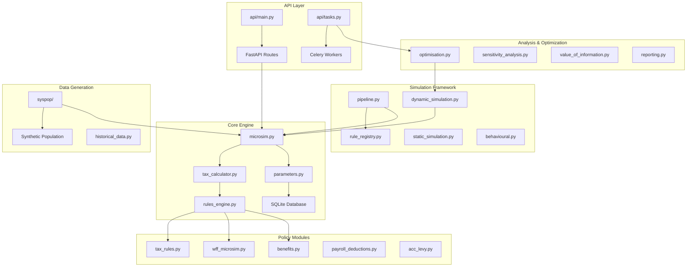
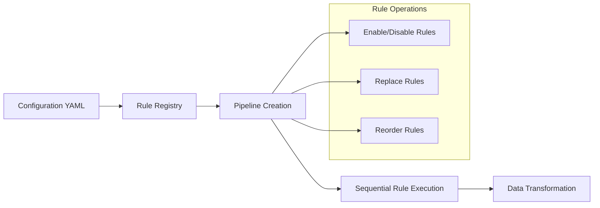
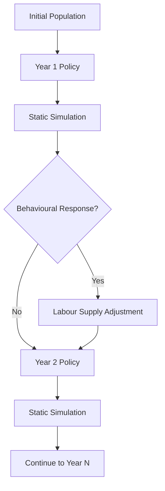
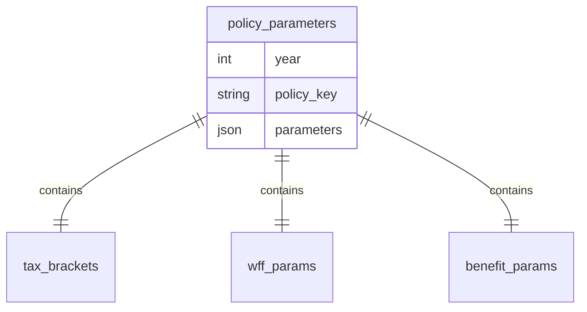
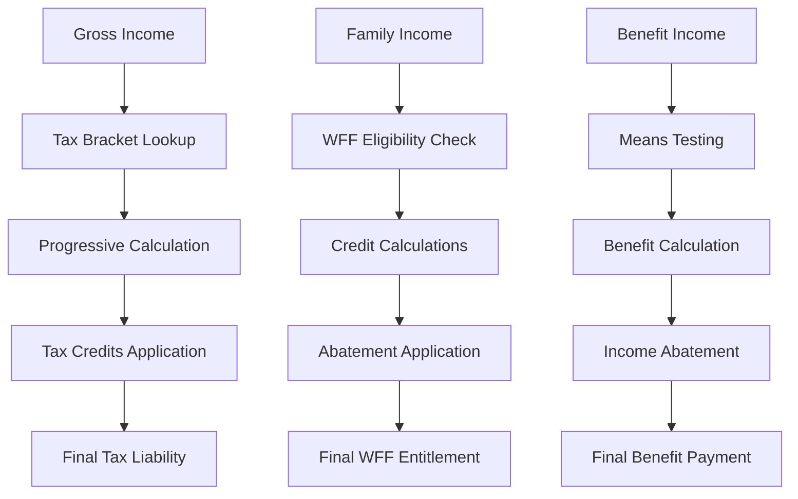
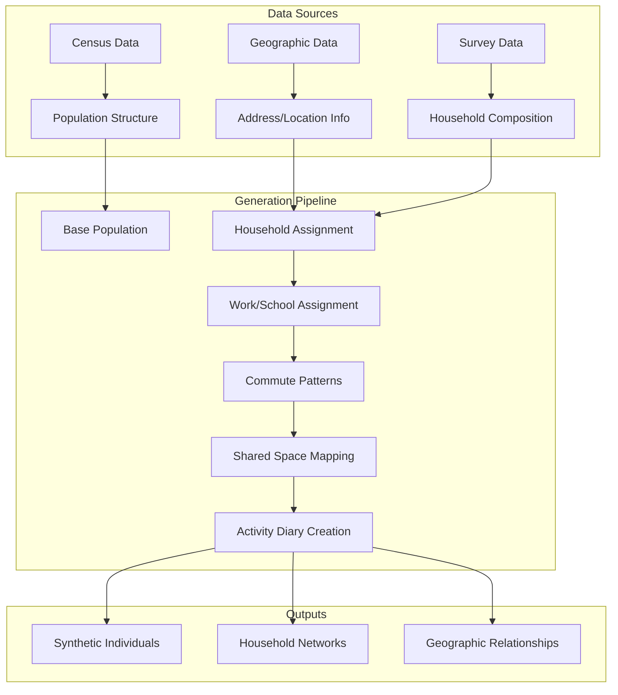

# NZ Tax Microsimulation Model - Repository Map

## Overview

The NZ Tax Microsimulation Model is a comprehensive Python-based microsimulation system designed for analyzing New Zealand's tax and benefit policies. It serves as a flexible, extensible tool for researchers, policymakers, and the public to explore the impacts of different tax and benefit policies through both static (single-year) and dynamic (multi-year) simulations.

## Technology Stack & Dependencies

### Core Dependencies
- **Python 3.9+** - Primary runtime environment
- **pandas** - Data manipulation and analysis
- **numpy** - Numerical computations
- **pydantic** - Data validation and settings management
- **FastAPI** - Web API framework
- **SQLite** - Parameter database storage
- **uvicorn** - ASGI server for web API
- **celery + redis** - Background task processing
- **optuna** - Policy optimization library

### Development & Analysis Tools
- **kedro** - Data pipeline framework
- **scipy** - Scientific computing
- **matplotlib + seaborn** - Data visualization
- **pytest** - Testing framework
- **joblib** - Parallel processing
- **faker** - Synthetic data generation

### Dual Language Support
- **Python** - Primary implementation
- **R** - Alternative implementation for certain components (syspop module)

## Component Architecture



## Core System Components

### 1. Microsimulation Engine (`src/microsim.py`)

The heart of the tax calculation system providing:

**Key Functions:**
- `load_parameters(year)` - Loads policy parameters from SQLite database
- `taxit(income, params)` - Progressive income tax calculation
- `calctax(income, split, params1, params2)` - Split-year tax calculation
- `calculate_net_weekly_income()` - Net income calculation with ACC levy

**Parameters System:**
- SQLite database storage (`src/data/parameters.db`)
- Pydantic model validation for type safety
- Historical coverage from 2005-2025 with fallback to 1890-2028

### 2. Tax Calculator (`src/tax_calculator.py`)

Convenience wrapper class that:
- Stores parameter sets for specific years
- Provides simplified interfaces for common calculations
- Handles parameter validation and caching

### 3. Policy Rule Modules

#### Working for Families (`src/wff_microsim.py`)
- Family Tax Credit (FTC)
- In-Work Tax Credit (IWTC) 
- Best Start Tax Credit (BSTC)
- Minimum Family Tax Credit (MFTC)
- Income abatement calculations
- Shared care adjustments

#### Benefits System (`src/benefits.py`)
- Jobseeker Support (JSS)
- Sole Parent Support (SPS)
- Supported Living Payment (SLP)
- Accommodation Supplement
- Winter Energy Payment

#### Payroll & Deductions
- ACC Earner's Levy (`src/acc_levy.py`)
- KiwiSaver contributions (`src/payroll_deductions.py`)
- Student loan repayments
- Independent Earner Tax Credit (IETC)

### 4. Simulation Pipeline (`src/pipeline.py`)

Modular rule execution system:



**Features:**
- YAML-based configuration
- Rule registry for dynamic loading
- Enable/disable/replace individual rules
- Sequential processing with data dictionary passing

### 5. Dynamic Simulation Framework (`src/dynamic_simulation.py`)

Multi-year simulation capabilities:



**Components:**
- Static simulation execution
- Behavioural response modeling
- Multi-year policy impact analysis
- Labour supply elasticity calculations

## Data Models & ORM Mapping

### Parameter Database Schema



### Pydantic Models (`src/parameters.py`)

**Core Parameter Classes:**
- `TaxBracketParams` - Progressive tax rates and thresholds
- `WFFParams` - Working for Families configuration
- `IETCParams` - Independent Earner Tax Credit settings
- `JSSParams`, `SPSParams`, `SLPParams` - Benefit parameters
- `AccommodationSupplementParams` - Housing assistance
- `ACCLevyParams` - ACC levy configuration

**Data Validation:**
- Type checking at runtime
- Field descriptions for documentation
- Default value handling
- Nested parameter validation

## API Endpoints Reference

### Web API (`src/api/main.py`)

FastAPI-based REST interface:

#### Data Management
- `POST /data/upload` - Upload population dataset (CSV)
- `GET /data/{dataset_id}` - Retrieve dataset metadata

#### Simulation Endpoints
- `POST /simulation/static` - Run single-year simulation
  - Parameters: year, dataset_id, parameter_overrides
  - Returns: tax_liability, wff_payments, record_count

#### Optimization & Background Jobs
- `POST /optimisation/run` - Start policy optimization (async)
- `GET /jobs/{job_id}` - Check background job status

#### Request/Response Schema

**StaticSimulationRequest:**
```python
{
    "year": "2024-2025",
    "dataset_id": "optional-uuid",
    "parameter_overrides": {
        "tax_brackets.rates[0]": 0.105,
        "wff.ftc1": 120.0
    }
}
```

**Authentication Requirements:**
- Currently no authentication implemented
- File upload size limits apply
- CSV format validation for datasets

## Business Logic Layer

### Tax Calculation Architecture



### Policy Rule Processing

**Rule Execution Pattern:**
1. Load parameters from database
2. Validate input data structure
3. Apply business logic calculations
4. Handle edge cases and exceptions
5. Return modified data dictionary

**Key Features per Module:**

#### Income Tax (`src/tax_rules.py`)
- Progressive bracket calculation
- Mid-year policy change handling
- RWT on investment income
- PIE tax calculations

#### WFF System (`src/wff_logic.py`)
- Multi-child family calculations
- Work hour eligibility checking
- Income abatement tiers
- Shared care adjustments
- Best Start age eligibility

#### Benefits Processing
- Means testing algorithms
- Relationship status consideration
- Regional accommodation supplements
- Seasonal payments (Winter Energy)

## Testing Strategy

### Test Coverage Areas

**Unit Tests (`tests/`):**
- `test_microsim.py` - Core calculation functions
- `test_tax_calculator.py` - Tax calculator wrapper
- `test_wff_microsim.py` - Working for Families logic
- `test_benefits.py` - Benefit calculation accuracy
- `test_pipeline.py` - Rule pipeline execution
- `test_api.py` - Web API endpoints

**Integration Tests:**
- `test_e2e.py` - End-to-end simulation workflows
- `test_historical_reporting.py` - Historical data validation
- `test_validation.py` - Model output validation

**Test Data:**
- Golden files for regression testing
- Synthetic population samples
- Historical policy parameter sets
- Edge case scenarios

### Validation Framework (`src/validation.py`)

**Validation Types:**
- Output comparison against known results
- Historical data consistency checks
- Cross-year parameter validation
- Policy rule interaction testing

## Synthetic Population Generation (syspop/)

### Architecture Overview

Dual-language implementation supporting both Python and R:



### Core Components

#### Population Synthesis (`syspop/syspop/start.py`)
- `create()` - Main population generation function
- Multi-area synthesis capability
- Modular component system

#### Demographic Modeling
- Age/gender distribution matching
- Ethnicity representation
- Household composition synthesis
- Family relationship modeling

#### Geographic Assignment
- Address allocation based on density
- Workplace assignment with commute patterns
- School enrollment modeling
- Shared space (hospitals, shops) access

#### Activity Generation
- Daily activity diary creation
- LLM-enhanced activity modeling
- Travel pattern simulation
- Social interaction modeling

### Integration with Tax Model

**Data Flow:**
1. Generate synthetic population with income attributes
2. Export to CSV format compatible with microsim
3. Load into tax calculation pipeline
4. Apply policy rules to synthetic individuals
5. Analyze distributional impacts

## Configuration & Customization

### Pipeline Configuration (`config/pipeline.yaml`)

YAML-based rule configuration:
```yaml
rules:
  - name: "income_tax"
    enabled: true
  - name: "wff_credits"
    enabled: true
  - name: "acc_levy"
    enabled: true
```

### Parameter Customization

**Database-driven Parameters:**
- Historical policy rule storage
- Version-controlled parameter changes
- Bulk parameter updates via SQL
- Export/import capabilities

**Runtime Overrides:**
- API-based parameter modification
- Sensitivity analysis parameter sweeps
- Optimization algorithm parameter search

### Extension Points

**Adding New Rules:**
1. Implement rule class with `__call__` method
2. Register in `rule_registry.py`
3. Add to pipeline configuration
4. Create unit tests

**Custom Behavioural Models:**
- Implement `BehaviouralFunc` interface
- Integration with `dynamic_simulation.py`
- Parameter specification in elasticity_params

## State Management

### Parameter State
- SQLite database persistence
- Pydantic model validation
- In-memory caching during simulation runs
- Version tracking for historical analysis

### Simulation State
- DataFrame-based data passing between rules
- Immutable parameter objects
- Stateless calculation functions
- Clean separation of data and logic

### API State Management
- File upload temporary storage
- Background job tracking via Celery
- Redis-based task queue management
- Session-less API design

## Workflow Examples

### Basic Tax Calculation Workflow
```python
# Load parameters for specific year
params = load_parameters("2024-2025")

# Calculate income tax
tax = taxit(income=60000, params=params.tax_brackets)

# Calculate tax credits
ietc = calcietc(income, params.ietc)

# Working for Families
wff_result = famsim(family_data, year=2024)
```

### Dynamic Simulation Workflow
```python
# Multi-year policy analysis
results = run_dynamic_simulation(
    df=population_data,
    years=["2023-2024", "2024-2025", "2025-2026"],
    use_behavioural_response=True,
    elasticity_params={"labour_supply": 0.25}
)
```

### Policy Optimization Workflow
```python
# Define optimization parameters
opt_config = {
    "objective": "maximize_welfare",
    "parameters": ["tax_brackets.rates", "wff.ftc1"],
    "constraints": {"budget_neutral": True}
}

# Run optimization
task = run_optimisation_task.delay(opt_config, "2024-2025", dataset_path)
```

## Development Status & Known Issues

### Current Development State

The NZ Tax Microsimulation Model is **functionally complete** with comprehensive tax and benefit calculation capabilities. However, several **integration and compatibility issues** exist that prevent some example scripts and tests from running properly.

### Test Suite Analysis

**Working Components:**
- ✅ Core tax calculation functions (`test_microsim.py`)
- ✅ Tax calculator wrapper (`test_tax_calculator.py`)
- ✅ Working for Families logic (`test_wff_microsim.py`)
- ✅ Benefits calculations (`test_benefits.py`)
- ✅ Parameter database loading (`test_parameters_access.py`)
- ✅ API endpoints (`test_api.py`)
- ✅ SQLite parameter database (60KB at `src/data/parameters.db`)
- ✅ Synthetic population test data (25 files in `syspop/etc/data/test_data/`)

**Issues Requiring Fixes:**

#### 1. Function Signature Mismatches

**Problem:** Many example scripts call `famsim()` with outdated parameter signatures.

**Current Signature:**
```python
def famsim(df, year, params_path=None, wagegwt=0.0, daysinperiod=365)
```

**Outdated Calls Found In:**
- `run_microsim_with_artificial_population.py` - Line 67
- `run_validation.py` - Line 49
- Various test files

**Fix Required:**
```python
# Instead of:
df_results = famsim(df, wff_params, wagegwt, daysinperiod)

# Use:
df_results = famsim(df, year=2024, wagegwt=wagegwt, daysinperiod=daysinperiod)
```

#### 2. Parameter File References

**Problem:** Scripts reference non-existent JSON parameter files.

**Files with Issues:**
- `test_e2e.py` - Line 85: `"src/params/2024-2025.json"`
- `run_validation.py` - Line 25: `"src/parameters_*.json"`
- `generate_reports.py` - Line 71: parameter file argument

**Current System:** Parameters are stored in SQLite database at `src/data/parameters.db`

**Fix Required:** Update all references to use `load_parameters(year)` function instead of JSON files.

#### 3. Synthetic Population Integration

**Status:** ✅ **Data files exist and are complete**

**Available Test Data:**
- Population structure, geography, household composition
- Work/commute patterns, schools, hospitals, shared spaces
- LLM diary data (16MB pickle file)
- Total: 25 parquet files in `syspop/etc/data/test_data/`

**Issue:** Example scripts use incorrect data directory paths

**Fix Required:**
```python
# In run_microsim_with_synthetic_population.py
# Change:
data_dir = os.path.abspath(os.path.join(os.path.dirname(__file__), "..", "syspop", "etc", "data", "test_data"))

# To verify path exists:
if not os.path.exists(data_dir):
    raise FileNotFoundError(f"Test data directory not found: {data_dir}")
```

#### 4. Pipeline Configuration Issues

**Problem:** Rule registration and pipeline configuration mismatches

**Files Affected:**
- `examples/pipeline_config.yaml` - References rules that may not be registered
- `src/rule_registry.py` - May be missing rule implementations

**Investigation Needed:**
- Verify all rules in pipeline configs are properly registered
- Check rule class implementations match expected interfaces

#### 5. **NEW: Missing API Dependencies**

**Problem:** API-related dependencies missing from requirements-dev.txt

**Missing Dependencies:**
- `fastapi` (in pyproject.toml but not requirements-dev.txt)
- `uvicorn` (in pyproject.toml but not requirements-dev.txt)
- `celery` (in pyproject.toml but not requirements-dev.txt)
- `redis` (in pyproject.toml but not requirements-dev.txt)

**Impact:** API and background job functionality will fail during development

**Fix Required:**
```bash
# Add to requirements-dev.txt:
echo "fastapi" >> requirements-dev.txt
echo "uvicorn" >> requirements-dev.txt
echo "celery" >> requirements-dev.txt
echo "redis" >> requirements-dev.txt
```

#### 6. **NEW: Validation Schema Constraints Mismatch**

**Problem:** `src/validation.py` has incorrect field constraints that don't match actual data patterns

**Specific Issues:**
- `FTCwgt: Field(ge=0, le=1)` - Should allow values > 1 for multiple children
- `IWTCwgt: Field(ge=0, le=1)` - Should allow values > 1 for multiple children  
- Other weight fields have similar restrictive constraints

**Evidence:** Test data uses `FTCwgt=2` for 2 children, which violates current schema

**Fix Required:**
```python
# In src/validation.py, change:
FTCwgt: int = Field(default=..., ge=0, le=1, description="Weight for Family Tax Credit.")

# To:
FTCwgt: int = Field(default=..., ge=0, description="Weight for Family Tax Credit (number of children).")
```

#### 7. **NEW: WFF Rules Implementation Gap**

**Problem:** Pipeline rules in `src/wff_rules.py` are placeholder implementations

**Current State:**
- Rules are registered correctly
- But implementations use dummy/hardcoded values
- Not connected to actual WFF calculation logic

**Example:**
```python
# Current placeholder in wff_rules.py:
def __call__(self, data: dict[str, Any]) -> None:
    df = data["df"]
    df["max_ftc"] = 1000  # Example values
    df["max_iwc"] = 500
```

**Fix Required:** Replace placeholder implementations with calls to actual WFF logic from `src/wff_logic.py`

#### 8. **NEW: Syspop Path Configuration Issues**

**Problem:** Syspop uses relative paths that depend on working directory

**Current Issue:**
```python
# In syspop/syspop/python/__init__.py:
NZ_DATA_DEFAULT = "etc/data/test_data"  # Relative path
```

**Fix Required:**
```python
# Change to absolute path based on module location:
import os
NZ_DATA_DEFAULT = os.path.join(os.path.dirname(__file__), "..", "..", "etc", "data", "test_data")
```

### Recommendations for Fixing

#### Phase 1: Critical Fixes (High Priority)

1. **Update Function Signatures**
   ```bash
   # Search and replace all famsim calls
   grep -r "famsim(" examples/ tests/
   # Update each instance to use new signature
   ```

2. **Fix Parameter Loading**
   ```python
   # Replace all JSON parameter references with:
   params = load_parameters("2024-2025")
   wff_params = params.wff
   ```

3. **Add Missing API Dependencies**
   ```bash
   # Add to requirements-dev.txt:
   cat << EOF >> requirements-dev.txt
   fastapi
   uvicorn
   celery
   redis
   httpx
   python-multipart
   EOF
   ```

4. **Fix Validation Schema Constraints**
   ```python
   # In src/validation.py, update field constraints:
   FTCwgt: int = Field(default=..., ge=0, description="Number of children for FTC")
   IWTCwgt: int = Field(default=..., ge=0, description="Number of children for IWTC")
   ```

5. **Fix Syspop Path Configuration**
   ```python
   # In syspop/syspop/python/__init__.py:
   import os
   NZ_DATA_DEFAULT = os.path.abspath(os.path.join(
       os.path.dirname(__file__), "..", "..", "etc", "data", "test_data"
   ))
   ```

#### Phase 2: Testing & Validation (Medium Priority)

1. **Run Core Tests**
   ```bash
   # Test basic functionality
   python -m pytest tests/test_microsim.py -v
   python -m pytest tests/test_wff_microsim.py -v
   python -m pytest tests/test_parameters_access.py -v
   ```

2. **Fix E2E Tests**
   ```bash
   # Update golden files if calculations are correct but format changed
   python examples/basic_usage.py
   diff basic_usage_output.txt tests/golden_basic_usage.txt
   ```

3. **Validate Example Scripts**
   ```bash
   # Test each example script individually
   python examples/basic_usage.py
   python examples/run_microsim_with_artificial_population.py
   ```

#### Phase 3: Implementation & Enhancement (Low Priority)

1. **Implement Real WFF Rules**
   - Replace placeholder WFF rules with actual logic from `src/wff_logic.py`
   - Connect pipeline rules to existing calculation functions
   - Test pipeline-based WFF calculations against direct function calls

2. **Pipeline Rule Integration**
   - Ensure all rule modules are imported for registration
   - Validate pipeline configurations reference existing rules
   - Add rule dependency management if needed

3. **Syspop Feature Optimization**
   - Identify minimal syspop features needed for tax simulation
   - Create lightweight population generation option
   - Remove unnecessary geographic/demographic features

### Detailed Fix Instructions

#### Fix 1: Function Signature Updates

**Files to Update:**
- `examples/run_validation_with_dummy_data.py:67`
- `examples/run_validation.py:49`
- Any other files found by: `grep -r "famsim.*wff_params" examples/ tests/`

**Change Pattern:**
```python
# OLD:
df_results = famsim(df, wff_params, wagegwt, daysinperiod)

# NEW:
df_results = famsim(df, year=2024, wagegwt=wagegwt, daysinperiod=daysinperiod)
```

#### Fix 2: Validation Schema Corrections

**File:** `src/validation.py`

**Changes:**
```python
# Remove restrictive constraints on weight fields:
FTCwgt: int = Field(default=..., ge=0, description="Weight for Family Tax Credit.")
IWTCwgt: int = Field(default=..., ge=0, description="Weight for In-Work Tax Credit.")
BSTC0wgt: int = Field(default=..., ge=0, description="Weight for Best Start Tax Credit (0-1).")
BSTC01wgt: int = Field(default=..., ge=0, description="Weight for Best Start Tax Credit (1-2).")
BSTC1wgt: int = Field(default=..., ge=0, description="Weight for Best Start Tax Credit (2-3).")
# ... etc for other weight fields
```

#### Fix 3: WFF Rules Implementation

**File:** `src/wff_rules.py`

**Replace placeholder implementations:**
```python
from .wff_logic import gross_up_income, calculate_max_entitlements, apply_care_logic

@register_rule
@dataclass
class GrossUpIncomeRule:
    def __call__(self, data: dict[str, Any]) -> None:
        df = data["df"]
        wagegwt = data.get("wagegwt", 0.0)
        data["df"] = gross_up_income(df, wagegwt)
```

### Expected Resolution Time

- **Phase 1 (Critical):** 4-6 hours of development time  
- **Phase 2 (Testing):** 4-6 hours including validation
- **Phase 3 (Implementation):** 12-16 hours for full WFF rules integration

### Priority Fixes Summary

#### **Immediate (Blocking Issues):**
1. Function signature mismatches - **2 hours**
2. Missing API dependencies - **30 minutes** 
3. Validation schema fixes - **1 hour**
4. Syspop path configuration - **1 hour**

#### **Short-term (Integration Issues):**
5. Parameter file references - **2 hours**
6. Golden test file updates - **2 hours**
7. Example script testing - **2 hours**

#### **Medium-term (Enhancement):**
8. WFF rules implementation - **8-12 hours**
9. Pipeline rule integration - **4-6 hours**

### Development Workflow for Fixes

```bash
# 1. Set up development environment
make install-dev-deps

# 2. Fix critical dependency issues
echo -e "fastapi\nuvicorn\ncelery\nredis\nhttpx\npython-multipart" >> requirements-dev.txt
pip install -r requirements-dev.txt

# 3. Run existing working tests to establish baseline
python -m pytest tests/test_microsim.py tests/test_tax_calculator.py -v

# 4. Fix function signatures in example scripts
# 5. Update validation schema constraints  
# 6. Fix syspop path configuration

# 7. Re-run tests after each fix
python -m pytest tests/test_e2e.py::test_basic_usage_e2e -v

# 8. Test example scripts
python examples/basic_usage.py
python examples/run_microsim_with_artificial_population.py

# 9. Full test suite
tox
```

**Conclusion:** The core microsimulation model is **development complete and functional**. The issues are primarily **integration and compatibility problems** in example scripts, API dependencies, validation schemas, and some tests, rather than fundamental flaws in the tax calculation engine. With focused fixes on the 8 identified issues, the system should be fully operational for all use cases including synthetic population generation and API functionality.